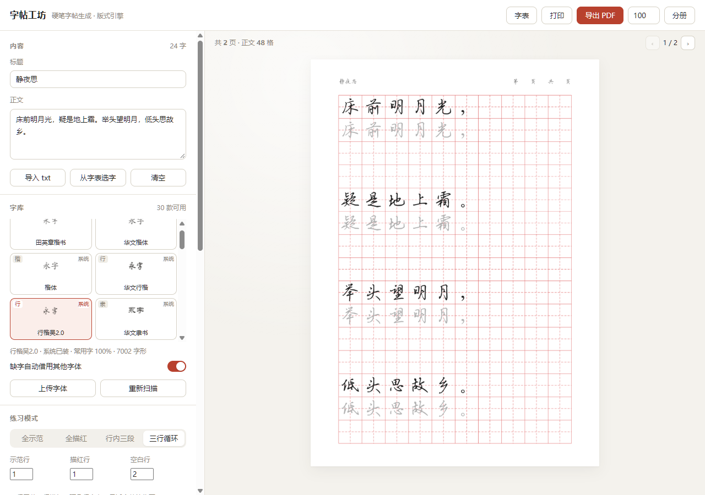

# 字帖工坊 · 硬笔字帖生成

把任意一段中文变成可打印的字帖。核心是三件事：**版式做对、内容喂饱、出口打通**。

面向成人硬笔练字场景，不追求"能出图"，追求"能直接印出来练"。

> 这个仓库 2023 年是一个单文件脚本（`main.py` 一把梭，只出田字格）；2026 年重写为
> FastAPI + Vue 的前后端分离版本，旧代码仍留在这份 git 历史里可查。



## 已经实现的能力

### 版式引擎

| 能力 | 说明 |
|---|---|
| 四种练习排法 | 全示范 / 全描红 / **行内三段**（示范→描红→空格）/ **三行循环**（示范行→描红行→空白行） |
| 七种格型 | 田字、米字、九宫、回宫、空白、竖线、横线 |
| 毫米级版面 | 格子边长按 mm 设定（8–30mm），自动换算像素，打印不变形 |
| 自动铺满 | 按纸张高度自动算每页行数，不留大片空白；放不下时自动缩格并提示 |
| 描红三态 | 浅灰（浓度 5%–80% 可调）/ 空心（双钩廓填）/ 点阵（点出笔顺走向） |
| 中文断行 | 避头尾禁则（断点前移一格，标点不居行首；开引号不悬行尾）+ 按标点断句 |
| 字形居中 | 按**墨迹包围盒**居中，不用字体行框（否则汉字偏上、标点掉出格子） |
| 缺字告警 | 字体没有的字形会明确报出来，不再静默消失（转繁体后按繁体字检查） |
| 文本清洗 | 保留 / 剔除标点（全角半角都算）、保留数字与字母、保留手动换行 |
| 简繁转换 | 一键转繁体（标题一起转），碑帖味更足；见下方「简繁转换的三个前提」 |

### 字库

| 能力 | 说明 |
|---|---|
| 字库可选 | 自动发现内置字库与**系统已装中文字体**（楷/行/隶/魏/宋/黑/圆），选择器里用各字体自身的字样渲染样张 |
| 覆盖度探测 | 按常用 3500 字算覆盖率、记录字形总数，选之前就知道会不会缺字 |
| 缺字回退 | 所选字库缺某个字时，自动从前面的字体链借用；标点借用静默处理，汉字借用会提示 |
| 上传字体 | 直接传 ttf/otf/ttc，落进 `backend/fonts/`；不含中文字形的文件会被拒绝 |
| 缓存 | 扫描结果按 (路径, mtime, 大小) 落盘缓存，冷启动约 3 秒，之后命中内存 |

### 内容供给

| 能力 | 说明 |
|---|---|
| 高频 1000 / 3500 字 | 按现代汉语语料频率排序，可当进阶字表 |
| 偏旁部首 231 个 | 含常见变形（氵亻扌讠忄…） |
| 笔画入门 114 字 | 由简到繁，配合笔顺练习 |
| 自动分册 | 设一个"每册字数"，一次导出 N 个 PDF 打包成 zip |
| 导入 txt / md | 保留编码兼容（UTF-8 / GB18030 / BIG5） |

### 出口

- **实时预览**：改任何参数，右侧即时重绘（后端低 dpi 快渲染 + 请求序号防闪回）
- **导出 PDF**：300dpi，页面尺寸精确到毫米，逐页落盘 + pypdf 合并，几十页也不吃内存
- **一键打印**：按导出 dpi 取高清页，弹打印窗口
- **分册打包**：3500 字拆 35 册，一次拿全

## 功能自检

每个开关都配了一条自检用例，跑法：

```bash
python tools/selftest.py          # 参数矩阵 + 规则断言
python tools/selftest.py --api    # 追加接口冒烟（需 pip install httpx）
python tools/selftest.py -v       # 附上每次渲染的指纹
```

判定方式不是「代码里有没有写」，而是**渲染前后比指纹**：像素哈希、画布尺寸、页数、
字数、缺字、借用字，六项全都不变即判为无效参数。规则类断言单独一组，检查结果对不对
（标点是否真的避开了行首、繁体是否真的换了字、关掉回退时是否如实报缺字）。

最近一次全量结果与逐项说明见 [`docs/功能自检.md`](docs/功能自检.md)。

## 目录结构

```
zitie-studio/
├── run.py                  一键启动（加载 dist + 起后端 + 开浏览器）
├── backend/
│   ├── app/
│   │   ├── main.py         FastAPI 路由
│   │   ├── schemas.py      参数模型（所有可调项都在这里）
│   │   ├── layout.py       文本清洗、断行禁则、练习行编排
│   │   ├── grid.py         七种格型绘制
│   │   ├── glyphs.py       字形蒙版 + 描红三态
│   │   ├── render.py       版面计算、分页、PDF 导出
│   │   ├── charsets.py     字表
│   │   └── fonts.py        字体注册（内置 + 系统发现 + 覆盖度 + 回退链）
│   ├── data/charsets.json  高频字表（构建时生成，运行时不依赖 wordfreq）
│   ├── data/fontcache.json 字体扫描缓存（自动生成，可删）
│   └── fonts/tk.ttf        田英章楷书
├── tools/selftest.py       功能自检（参数矩阵 + 规则断言 + 接口冒烟）
└── frontend/               Vue 3 + Vite
    └── src/
        ├── App.vue         控制面板 + 预览
        ├── api.js
        ├── style.css
        └── components/     Seg / Toggle / GridIcon / CharPicker / FontPicker
```

## 启动

### 生产模式（一条命令）

```bash
cd zitie-studio/frontend && npm install && npm run build
cd .. && python run.py
```

打开 http://127.0.0.1:8000

> npm 若报 `@esbuild/win32-x64 could not be found`，补一句 `npm i -D @esbuild/win32-x64` 再构建。

### 开发模式（前后端分离热更新）

```bash
# 终端 1
cd backend && pip install -r requirements.txt
uvicorn app.main:app --reload --port 8000

# 终端 2
cd frontend && npm run dev     # http://localhost:5173，/api 已代理到 8000
```

## API

| 方法 | 路径 | 说明 |
|---|---|---|
| GET | `/api/meta` | 字体、字表、格型、纸张、默认参数，以及 `capabilities.traditional`（是否装了 zhconv） |
| GET | `/api/fonts?refresh=1` | 字体清单（`refresh=1` 重新扫描） |
| GET | `/api/fonts/{id}/sample?text=永字` | 用该字体画出的样张 PNG（透明底） |
| POST | `/api/fonts/upload` | 上传 ttf/otf/ttc，仅收含中文字形的 |
| GET | `/api/charset/{id}` | 取某张字表的全部字 |
| POST | `/api/preview` | `{params, page, full}` → base64 PNG + 页数 + 告警 |
| POST | `/api/export` | `{params, split_size}` → PDF 或分册 zip |
| POST | `/api/parse` | 上传 txt/md 取正文 |

`params` 字段见 `backend/app/schemas.py`，前端每个控件都对应其中一个字段。

## 几个关键取舍

**为什么不用 PyPDF2 合并单页文件**：先用 PIL 逐页存成单页 PDF，再用 pypdf 追加。这样几十页的字帖内存平稳，也不会出现"按文件名排序导致 10.pdf 排在 2.pdf 前面"这类页码错乱。

**为什么按墨迹居中而不是 `anchor='mm'`**：`anchor` 对齐的是字体行框（含上下留白），汉字会偏上、标点会掉到格子外面。改成先渲染到 2 倍画布、量出实际落墨范围、再平移对齐，才算真正居中。

**为什么单字模式丢掉标点**：单字重复练习一行只练一个字，标点单独占一行既无意义也不好看，直接剔除。

**为什么避头尾要挪断点而不是挪标点**：一开始的写法是「等标点被顶到行首，再把标点和前一个字一起挪到下一行」，结果 5 格排「春眠不觉晓，」时，标点直接成了第二行第一个字——避了个寂寞。正确做法是先按格数切出候选断点，再看断点后面那个字是不是标点，是就把断点前移一格。断点只会前移，行永远不超过格数，格子是固定的。

**为什么字库要扫系统字体而不是只放几个 ttf**：楷书只适合入门，练到一定阶段会想看行楷、隶书、魏碑的写法差别。系统里往往已经装了十几款中文字体，直接读路径就能用，既不占仓库体积，也不涉及再分发。内置字库仍保留一份，保证换台机器也开箱可用。

**为什么字体名优先取中文记录**：`simkai.ttf` 的英文字段是 `KaiTi`，中文记录才是「楷体」，而某些字库（吴玉生行楷）干脆只有 `Lw42.0` 这种内部代号——所以按 langID 2052 → 1028 → 1033 的顺序取，实在没有再用文件名。

## 已知限制

- **转繁体依赖 `zhconv`**（MIT，已在 `requirements.txt`）。没装时前端开关直接置灰并说明原因，接口返回 400 而不是静默输出简体——这一点是刻意做的：静默降级会让人以为功能坏了却查不出原因。
- **简繁是字表 + 词组表，不是分词模型**。`里`这类多音字 zhconv 会一律转成「裏」，本项目对「公里 / 千里 / 万里 / 里程 / 里弄」做了修正，其他量词搭配仍可能误转，正式付印前请通读一遍。
- **「按标点断句」只在每句都放得进一行时生效**，否则退回硬切，避免出现一行只剩三个字的碎行。
- 内置只有一款字体（田英章楷书，7542 字形）。系统字体可用数量取决于机器，Linux 服务器上可能一款都没有——此时只有内置楷书，选择器会只剩一个选项。
- 缺字回退是逐字挑字体，不做字形风格匹配：借用来的字可能和主字体风格不一致（例如行楷里混进一个宋体字），介意的场合请关掉回退，改用覆盖更全的字库。
- 单次导出上限 200 页，分册上限 40 册。
- 字体版权需自行确认，商用请替换为已授权字库（把 ttf 放进 `backend/fonts/` 即可，前端会自动列出）。系统字体只在本机读取，随项目分发时不包含它们。

## 下一步（未实现，按优先级）

1. 描红之外的"空格式对临"模板（原帖 + 空格并排）
2. 碑帖切片字库与单字跨书家对比
3. 笔顺动画
4. 拍照批改与结构标注
5. 打印装订下单
