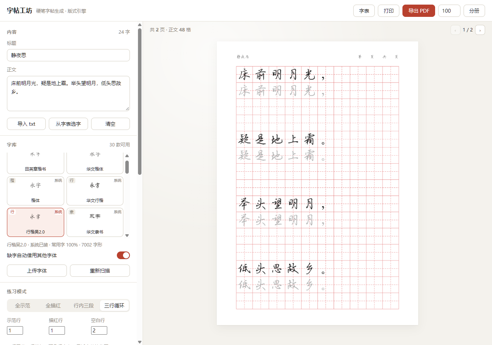

# 字帖工坊 · 硬笔字帖生成

把任意一段中文变成可打印的字帖。强项是**版式做对**（毫米级、避头尾、墨迹居中、缺字回退），并补齐了内容供给、配置留存、出口格式与多页交互。按**本机／内网自用**定位，只在本机或内网运行。

> 本仓库是唯一维护地址，旧脚本的完整历史已合并于此。

## 用 WorkBuddy 部署（推荐）

在 WorkBuddy 中打开本仓库目录，说一句“启动字帖工坊”即可。WorkBuddy 会自动装依赖、构建前端并启动服务，在预览面板打开页面；默认 `http://127.0.0.1:8000`，**无需手工配环境或记命令**。

| 自动执行 | 对应命令 |
|---|---|
| 装后端依赖 | `pip install -r backend/requirements.txt` |
| 装前端依赖并构建 | `cd frontend && npm install && npm run build` |
| 启动服务 | `python run.py` |

改前端代码刷新页面即可；改后端代码需重启服务（`run.py` 无热重载）。不用 WorkBuddy 时，按下方“手工启动”执行同样三步。



## 能力一览

| 层 | 已实现 |
|---|---|
| 练习排法 | 全示范／全描红／行内三段／三行循环／对临／**渐隐**（每行首字实心、逐格变淡）／**生字卡**（范字→描红→空白），共 7 种 |
| 排版方向 | 横排／**竖排**（自右向左换列、自上而下；编排数据不变，仅绘制时做坐标变换） |
| 格型 | 田字、米字、九宫、回宫、空白、竖线、横线、四线三格、作文格、控笔格（波浪／螺旋／折线／8 字轨迹），共 10 种 |
| 版面 | 格子 8–30mm 按毫米设定；自动铺满页高、放不下自动缩格；纸色／格线色／字色独立可调，含碑帖黑底（描红按纸色混合、页眉反色） |
| 字形 | 描红三态（浅灰浓度 5%–80%／空心双钩／点阵）；按**墨迹包围盒**居中；缺字明确告警；简繁一键转换 |
| 文本 | 避头尾禁则＋按标点断句；标点、数字字母、手动换行可分别保留 |
| 字库 | 自动发现系统已装中文字体并显示自身字样；按 3500 常用字算覆盖率；缺字跨字体回退；可上传 ttf/otf/ttc；扫描结果落盘缓存 |
| 内容 | 高频 1000／3500 字、偏旁 231、笔画入门 114、分级字表三档（**非教材原表**）；古今 **11 类 52 篇**诗文，可搜索、替换或追加 |
| 难度 | 按常用字覆盖率、字频排名、生僻字、篇幅、重复率算 1–5 星，推荐同级巩固／进阶篇目；纯本地计算，不联网、不要 Key |
| 出口 | 300dpi PDF／PNG、选页 `1-2,4`、整本打印、分册 zip、多页 PNG 自动打包；页面尺寸精确到毫米 |
| 交互 | 实时预览、缩略图页导航、页码跳转、缩放与键盘翻页、日夜主题、**内容／字形／版式／输出**四组吸顶标签、超宽屏铺满 |
| 配置 | 参数自动存档、我的模板、分享链接（deflate 压进 URL hash）、最近 5 次选页写法 |

## 手工启动

依赖 Python 3.10+、Node 18+。

```bash
pip install -r backend/requirements.txt
cd frontend && npm install && npm run build && cd ..   # 产物落在 backend/web
python run.py                                          # http://127.0.0.1:8000
```

> npm 若报 `@esbuild/win32-x64 could not be found`，补 `npm i -D @esbuild/win32-x64` 再构建。

### 纯静态版（单个 HTML，本机／内网）

```bash
cd frontend && npm run build:standalone   # 产出 standalone/index.html，约 206 KB
```

HTML、CSS、JavaScript、内容库与字表全部内联，**零外部请求、零运行时依赖**。三种用法：

| 用法 | 操作 |
|---|---|
| 双击打开 | 直接打开 `index.html`（`file://`），完全离线，分享按钮只给配置码 |
| 发文件 | 把这一个文件用微信／邮件发出去，对方双击即可用 |
| 本机／内网静态目录 | `python -m http.server 8018 --directory standalone`，同网段改成主机 IP 即可共享 |

`api.js` 启动时探测 `/api/health`：拿到合法 JSON 走 Python 后端，否则自动切浏览器 Canvas 引擎——编排、格型、横竖排、描红、导出全部本地完成。可用 `?engine=local` / `?engine=remote` 强制指定，右上角显示当前引擎。

| 项目 | 桌面版 | 静态版 |
|---|---|---|
| 字体 | 扫描系统全部字体、缺字回退 | 8 款 CSS 字体栈；上传字体仅当前会话有效 |
| 转繁体 | zhconv 词表 | 不提供，开关自动隐藏 |
| 导出 | PIL 逐页 PNG + pypdf 合并 | Canvas 逐页 JPEG + 内置 PDF/ZIP 生成器 |

两种 PDF 都是**位图**。分享链接的 `#cfg=` 只是配置码，不能脱离承载页面独立访问；`file://` 下只复制配置码，贴回同一页面地址栏即可还原。

### 开发模式

```bash
cd backend && uvicorn app.main:app --reload --port 8000   # 终端 1
cd frontend && npm run dev                                # 终端 2，http://localhost:5173
```

## API

| 方法 | 路径 | 说明 |
|---|---|---|
| GET | `/api/health` | 健康检查，带版本号 |
| GET | `/api/meta` | 字体、字表、内容库、格型、纸张、默认参数、`capabilities` |
| GET | `/api/fonts?refresh=1` | 字体清单（`refresh=1` 重新扫描） |
| GET | `/api/fonts/{id}/sample?text=永字` | 该字体的样张 PNG（透明底） |
| POST | `/api/fonts/upload` | 上传 ttf/otf/ttc，仅收含中文字形的 |
| GET | `/api/charset/{id}` | 取某张字表的全部字 |
| GET | `/api/library`、`/api/library/{id}` | 内容库分组（含全文）／单篇 |
| POST | `/api/analyze` | `{text, title, keep_punct}` → 1–5 星难度、可解释指标、三篇推荐 |
| POST | `/api/preview` | `{params, page, full}` → base64 PNG + 页数 + 告警 |
| POST | `/api/thumbnails` | `{params, width, limit}` → 全部页缩略图 |
| POST | `/api/print` | `{params, page_range, limit}` → 选中页高清图，一次打印整本 |
| POST | `/api/export` | `{params, split_size, file_format, page_range}` → PDF／PNG／分册 zip |
| POST | `/api/parse` | 上传 txt/md 取正文 |

`params` 全部字段见 `backend/app/schemas.py`；`page_range` 写法如 `1-2,4`，留空为全部，越界返回 400；PNG 选中多页时自动打包 zip。

## 内容库

| 时代 | 分类（篇数） |
|---|---|
| 古代 37 | 先秦史传 4、史记 5、诸子散文 6、古文名篇 7、唐诗／宋词／蒙学／成语 15 |
| 现代 15 | 现代散文 9、现代诗歌 4、现代杂文 2 |

含《左传》郑伯克段于鄢、曹刿论战，《史记》项羽本纪／陈涉世家／廉颇蔺相如列传，朱自清《背影》《荷塘月色》，鲁迅《秋夜》，徐志摩《再别康桥》等。单篇 24–77 字节选，正好铺两三行；文库按时代筛选、卡片标星级，难度推荐池同步覆盖 52 篇。

**版权口径**：古代为公有领域典籍；现代只收**作者逝世满 50 年**、依中国著作权法已进入公有领域者，叶圣陶、冰心、巴金、沈从文、艾青等仍在保护期一律不收。节选供临写，正式引用请核对原书版本。

## 自检

```bash
python tools/selftest.py                  # 原有参数矩阵 + 规则断言（-v 附指纹，--api 追加接口冒烟）
python tools/selftest_upgrade.py --api    # 升级项指纹 + 新接口冒烟（需 httpx）
(cd frontend && npm run test:api)         # api.js 真实调用链（需后端已启动）
(cd frontend && npm run test:local)       # 浏览器引擎全链路（无需后端）
(cd frontend && npm run build:standalone) # 重建静态版
```

判定方式是**渲染前后比指纹**（像素哈希、画布尺寸、页数、字数、缺字、借用字），不检查代码里写没写；规则类断言另查避头尾、繁体换字、缺字报告。手写的 PDF／ZIP 另用 `pypdf` 与 `zipfile.testzip()` 验收。逐项说明见 [`docs/功能自检.md`](docs/功能自检.md)。

## 目录结构

```
run.py                        一键启动
backend/app/
  main.py schemas.py          FastAPI 路由 / 参数模型
  layout.py grid.py           文本清洗、断行禁则、七种排法 / 十种格型
  glyphs.py render.py         字形蒙版与描红三态 / 横竖排版面、分页、导出
  charsets.py difficulty.py   字表与古今内容库 / 离线难度与推荐
  fonts.py                    字体发现、覆盖度、回退链
backend/data/                高频字表、字体扫描缓存（自动生成）
backend/fonts/tk.ttf         内置田英章楷书
backend/web/                 前端构建产物
standalone/index.html        单文件静态版
frontend/src/
  App.vue style.css          控制面板 + 预览
  api.js                     双引擎自动探测
  local-engine.js            浏览器渲染引擎 + PDF/ZIP 生成
  static-data.js share.js    内容库快照 / 分享链接压缩
  components/                Seg / Toggle / GridIcon / CharPicker / FontPicker
                             / LibraryPicker / TemplateDrawer
frontend/scripts/             smoke-api / smoke-local / build-standalone
tools/                        selftest.py / selftest_upgrade.py / gen_static_data.py
```

## 关键取舍

| 决策 | 原因 |
|---|---|
| pypdf 合并单页 PDF | 逐页落盘内存平稳，避免文件名排序把 `10.pdf` 排到 `2.pdf` 前 |
| 墨迹包围盒居中而非 `anchor='mm'` | 行框含上下留白，会让汉字偏上、标点掉出格子 |
| 避头尾前移断点而非挪标点 | 挪标点会让它变成下一行首字；前移断点则行永不超格数 |
| 扫描系统字体而非只放几个 ttf | 便于对比楷／行／隶／魏写法，不占仓库体积、不涉及再分发 |
| 字体名取中文记录（langID 2052→1028→1033） | 英文字段常是 `KaiTi`、`Lw42.0` 一类代号 |
| 不采纳笔顺动画／PWA／AI 组词 | 需几十 MB 笔画数据或外部 Key，破坏零外部依赖定位 |

## 已知限制

- 转繁体依赖 `zhconv`；未安装时开关置灰、接口返回 400，不静默降级。简繁是字表＋词组表，`里`类多音字仍可能误转（已修正公里／千里／万里／里程／里弄），付印前请通读。
- “按标点断句”只在每句都放得进一行时生效，否则退回硬切。
- 内置仅田英章楷书一款（7542 字形）；系统字体数量取决于机器。缺字回退不做字形风格匹配，介意时请关掉回退。
- 单次导出上限 200 页、分册 40 册；一次打印 30 页、缩略图 40 页，超出请导出 PDF。导出 PDF 是 300dpi **位图**，文字不可选中。
- 静态版不枚举系统字体、不支持转繁体；竖排下标点仍按横排字形绘制，四线格／作文格／控笔格自动回退田字格。
- 难度星级是按内置篇目标定的相对参考值，衡量练字吃力程度，不是教材难度认证。
- 字体版权需自行确认；系统字体只在本机读取，不随项目分发。商用请替换为已授权字库（放入 `backend/fonts/` 即自动列出）。

## 同类项目调研与升级

源项目版式引擎在同类里属第一梯队，短板在内容、配置、出口、多页交互四层，已分三版补齐：

| 参考项目 | 值得借鉴 | 处理 |
|---|---|---|
| [myadmin/CopyBook](https://github.com/myadmin/CopyBook) | 模板、URL 分享、选页导出、缩略图导航、PNG、四线三格、古诗词库、碑帖黑底、PWA | 采纳前 8 项；PWA 不采纳（静态版本身单文件离线） |
| [lcfactorization/calligraphy-sheet-generator](https://github.com/lcfactorization/calligraphy-sheet-generator) | 学习闭环、难度星级、生字卡、离线推荐、矢量 PDF、AI 引擎 | 采纳主题／模板／持久化、难度与推荐、生字卡；笔顺弹窗与 AI 不采纳 |
| [WenJunDuan/calligraphy](https://github.com/WenJunDuan/calligraphy) | 控笔训练、拼音标注 | 采纳控笔格型 |
| [bulanzade/moyun](https://github.com/bulanzade/moyun) | 浅色参考字、颜色档位 | 吸收为四套配色预设与渐隐临摹 |
| hanzi-writer | 笔顺动画、上下文注音 | 不采纳：需 49MB 笔画数据与 CDN |

| 版本 | 主要升级 |
|---|---|
| v2 | 内容库、模板／分享链接／参数存档、PDF／PNG 双格式与选页、缩略图导航、四线三格／作文格／控笔格、对临、碑帖黑底 |
| v2.1 | 四组选项卡、**竖排**、渐隐临摹、生字卡、难度评估与推荐、分级字表 |
| v2.2 | 浏览器渲染引擎与单文件静态版、内容库扩至古今 11 类 52 篇 |

竖排只在 `render_page()` 做坐标变换，避头尾、分页、七种排法与导出链路零改动复用；渐隐只覆盖颜色浓度、字形蒙版仍走缓存；黑底描红改为按纸色混合、页眉自动反色。

## 下一步

1. 矢量 PDF 出口（需重写渲染后端，把格线、描红三态与控笔轨迹矢量化）
2. 碑帖切片字库与单字跨书家对比
3. 笔顺动画（需约 49MB 离线笔画数据）
4. 拍照批改与结构标注
5. 打印装订下单
